<div align="center">

# 絆 kizuna

<p><strong>One web interface for PostgreSQL, Redis, and Kafka.</strong><br>
Browse data, work with messages, and follow related records without switching tools.</p>

[](LICENSE)
[](https://go.dev)
[](https://react.dev)
[](https://hub.docker.com/r/zxchlorka/kizuna)

English · [Русский](README.ru.md)

</div>

<p align="center">
  <picture>
    <source srcset=".github/assets/hero.webp" type="image/webp">
    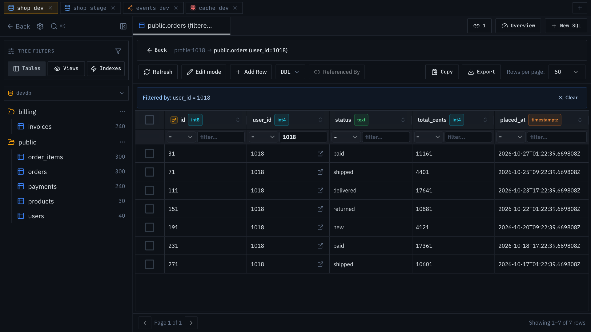
  </picture>
</p>

## Why Kizuna

Kizuna replaces a scattered set of pgAdmin, Redis Desktop Manager, and Kafka UI with one compact application. Its goal is to make everyday data work faster: open a table, key, or message, change what you need, then jump straight to the related entity in another source.

It is a self-hosted tool for engineers, analysts, and support teams. In production it runs as one container and never sends your data to an external service.

## Quick Start

```bash
docker run -d --name kizuna -p 127.0.0.1:9090:9090 -v kizuna-data:/data zxchlorka/kizuna
```

Open [http://localhost:9090](http://localhost:9090) and add your first connection. Configuration lives in the `kizuna-data` Docker volume; connection passwords are encrypted with AES-256-GCM. The image is built for amd64 and arm64 and is also on GHCR: `ghcr.io/zxchlorka/kizuna`.

To update, run `docker pull zxchlorka/kizuna && docker rm -f kizuna`, then the same `docker run` command; your connections stay in the volume.

<details>
<summary><b>Docker Compose</b></summary>

```yaml
services:
  kizuna:
    image: zxchlorka/kizuna
    ports:
      - "127.0.0.1:9090:9090"
    volumes:
      - kizuna-data:/data
    restart: unless-stopped

volumes:
  kizuna-data:
```

</details>

<details>
<summary><b>Build from source</b></summary>

```bash
git clone https://github.com/zxchlorka/kizuna.git
cd kizuna
docker compose up -d --build
```

Without Docker you need Go 1.26+ and Node 20+:

```bash
cd frontend && npm install && npm run build && cd ..
go run ./cmd/kizuna
```

The frontend is embedded in one Go binary; the app listens on port `9090`.

</details>

## Connections

Connect all three source types from one wizard: **PostgreSQL**, **Redis**, and **Kafka**. Redis supports standalone, Cluster, and Sentinel; Kafka supports multiple brokers, SASL, and TLS with a custom CA bundle; PostgreSQL supports TLS up to `verify-full` and filling the form from a pasted connection string.

- Connections can be searched, filtered, and grouped by tag. A connection tagged `production` opens under a warning banner.
- The address bar carries the open object and its filters, so an investigation can be handed to a teammate as a link.
- Tabs and SQL drafts survive a page reload.

<p align="center">
    <picture>
      <source srcset=".github/assets/connections-types.webp" type="image/webp">
      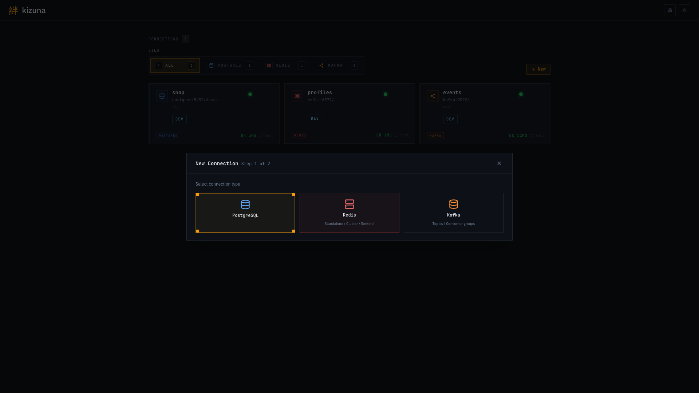
    </picture>
</p>

## ⌘K — jump anywhere

**⌘K** (Ctrl K) jumps to any connection, table, view, topic, or Redis namespace from any page. Typing `ord` finds `public.orders` on every connection that has it; a second word narrows by connection: `ord stage`. It searches only what the browser already holds, so opening it never sends a query to your databases.

<p align="center">
  <picture>
    <source srcset=".github/assets/command-palette.webp" type="image/webp">
    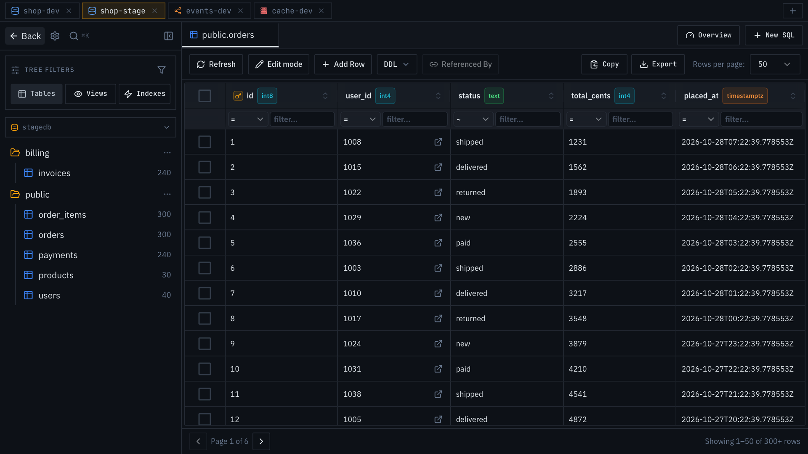
  </picture>
</p>

## PostgreSQL — from schema to query

Open a schema, table, or view directly from the tree. The table view provides sorting, filters, pagination, column types, and quick foreign-key navigation. Edit mode supports bulk changes, row creation, and deletion, while breadcrumbs retain navigation context.

<p align="center">
  <picture>
    <source srcset=".github/assets/postgres-explorer.webp" type="image/webp">
    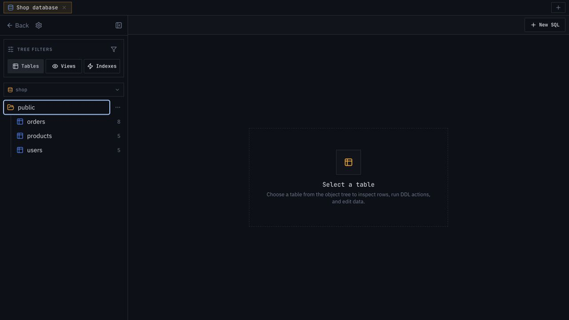
  </picture>
</p>

- SQL console with autocomplete, history, multi-statement scripts, safe `EXPLAIN`, and confirmed `EXPLAIN ANALYZE`.
- DDL actions and an index inspector without switching to another client.
- Forward and reverse foreign keys: jump to a parent row, inspect **Referenced By**, and return through breadcrumbs.
- **Show DDL** prints the `CREATE` statement for a table, view, or materialized view, the way `pg_dump` writes it.
- **Overview**: active sessions and locks, heavy statements from `pg_stat_statements`, table sizes and dead tuples, replication lag, unused indexes, sequences nearing their ceiling.
- Copy a row as `SELECT`, `INSERT`, `UPDATE`, or `DELETE`; export results as CSV or JSON.
- `bigint` and `numeric` values are shown exactly as stored, never rounded through a double.

<p align="center">
  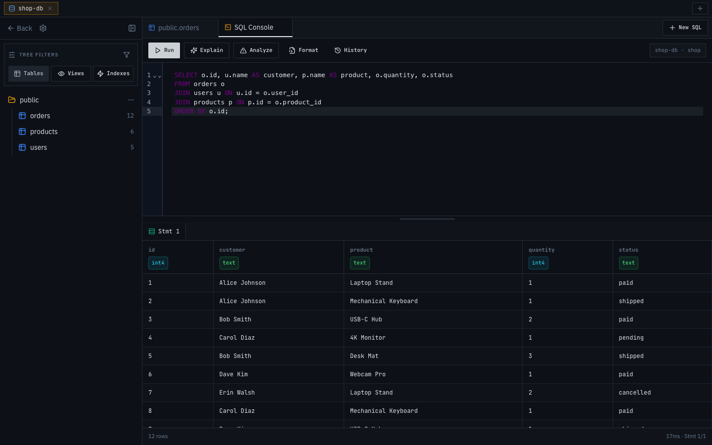
</p>

## Redis — keys, types, and CLI

The key tree is grouped by prefix. Kizuna opens the right editor for String, Hash, List, Set, Sorted Set, Stream, and RedisJSON; TTL, key creation, and bulk actions stay in the same workspace.

The built-in Redis CLI formats command output and adds an `open <key>` button for a recognized key. After `HGETALL profile:1001`, for example, you can open `profile:1001` in its typed editor immediately—without copying the key name.

- **Overview**: memory against `maxmemory`, eviction, fragmentation, and for a cluster, its masters and a map of all 16384 slots, missing ones included.
- Compare up to five keys of one type: shared values are highlighted, and comma-separated lists are compared element by element.
- Rename, duplicate, copy a key to another connection or out as JSON — in a cluster too, and without `RESTORE` permission.
- Filter the tree with server-side `SCAN MATCH`, and export a namespace's ids as a JSON list.

<p align="center">
  <picture>
    <source srcset=".github/assets/redis-cli.webp" type="image/webp">
    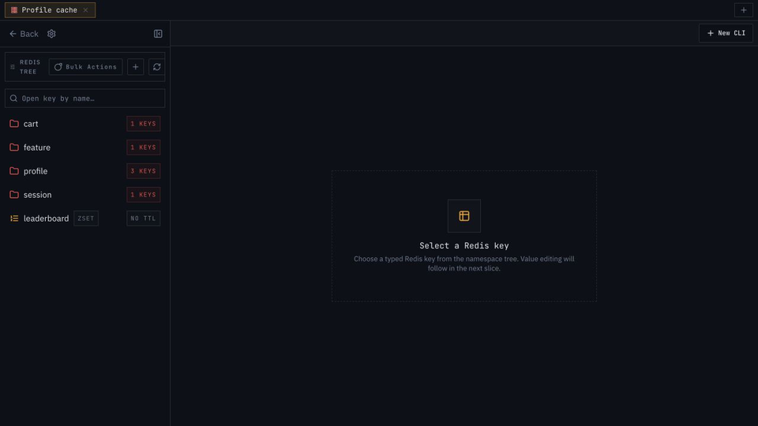
  </picture>
</p>

<p align="center">
  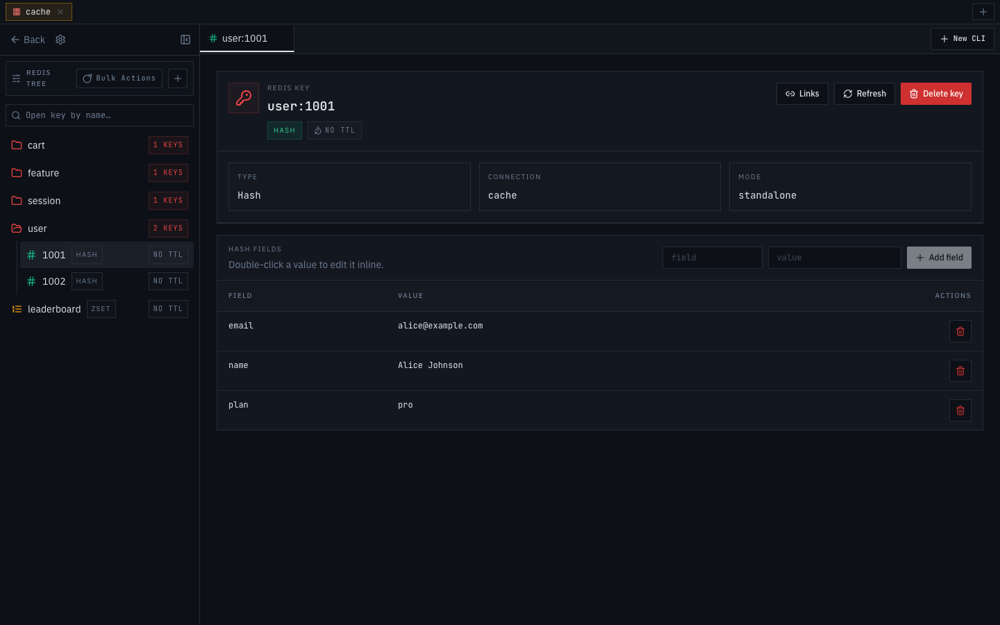
</p>

## Kafka — messages and controlled produce

Browse topics, partitions, consumer groups, and JSON messages in one view. Message fields can also drive filters and related-data navigation.

The producer can send one message, a batch of comma-separated JSON objects in **Multi** mode, or a template-expanded batch in **Loop** mode. Before publishing, Kizuna previews every exact message, so you can validate `{{i}}` expressions, step, and count before writing to Kafka.

- Search a topic by key, header, or JSON fields, with several conditions joined by AND/OR and `equals` / `contains` / "field exists". The scan shows its progress and can be stopped at any point.
- Seek by offset or time, and read newest-first or oldest-first.
- Chosen JSON fields can be shown as their own columns.
- Reset a consumer group's offsets to the start, the end, or a point in time; before anything is sent, you see how many messages the group will re-read or skip.
- The Config tab shows every topic setting with where its value comes from and what it would be without the override.

<p align="center">
    <picture>
      <source srcset=".github/assets/kafka-produce.webp" type="image/webp">
      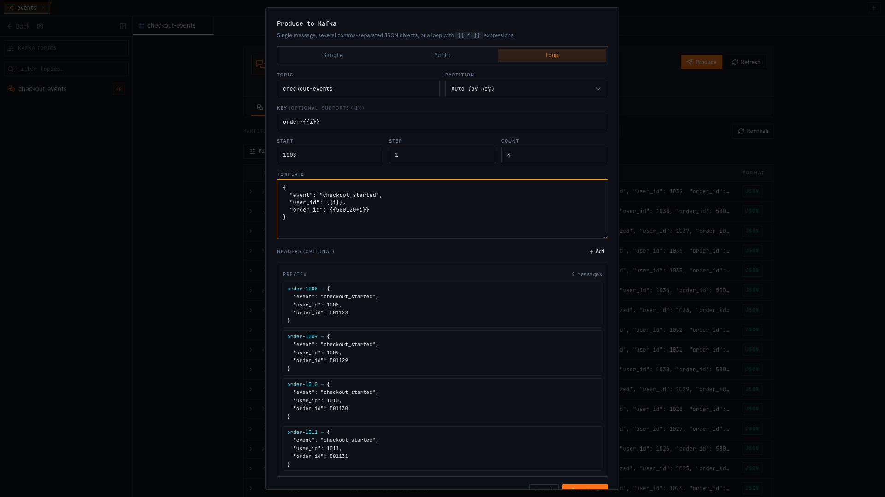
    </picture>
</p>

<p align="center">
  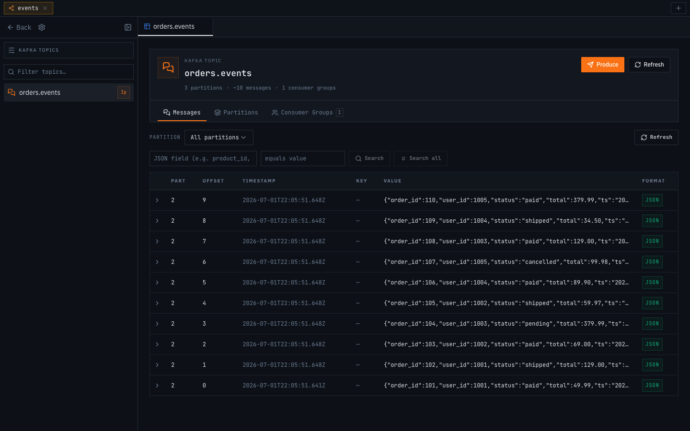
</p>

## Cross-source links

The same value lives in three places at once: `user_id` in a Kafka event, the `profile:1008` key in Redis, a column in `public.orders`. Normally that means copying it from window to window. Kizuna lets you describe the jump once.

**Setup takes half a minute.** Right-click a message → **Create link…** → point at the `user_id` field and say it addresses the `profile:*` key in Redis. Done.

**After that it just works.** Right-click any message in that topic and the menu already offers `Redis: profile:1008`. From there the same gesture opens `public.orders` filtered by that same `user_id`. Kizuna builds the filter, the breadcrumb, and the reverse jumps itself — nothing gets copied by hand.

The clip below shows exactly that: the menu is empty, then the jump appears in it.

Links work both ways: an open record shows where to go next and where you came from.

<p align="center">
    <picture>
      <source srcset=".github/assets/cross-source-links.webp" type="image/webp">
      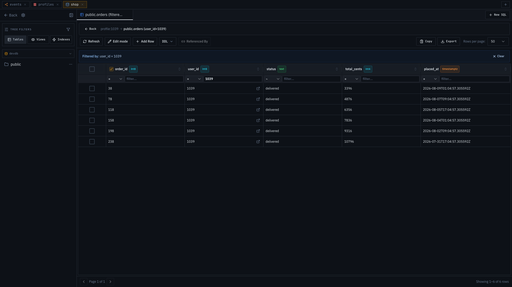
    </picture>
</p>

<p align="center">
  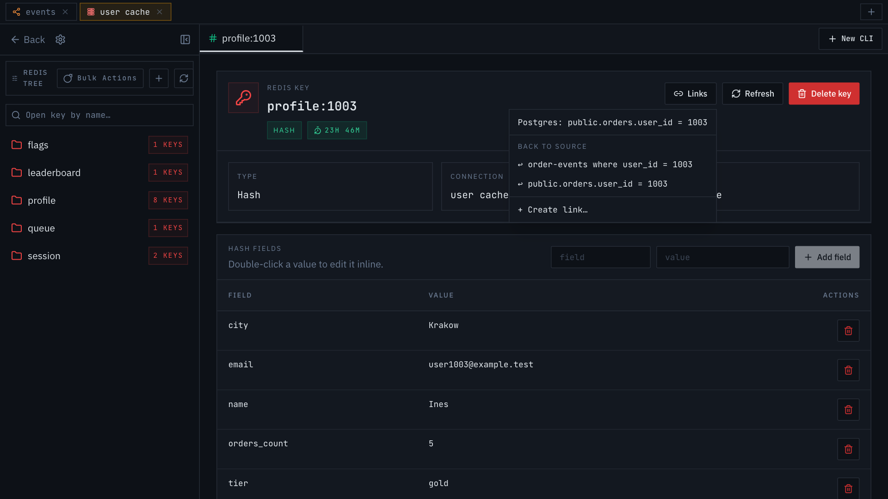
</p>

<p align="center">
  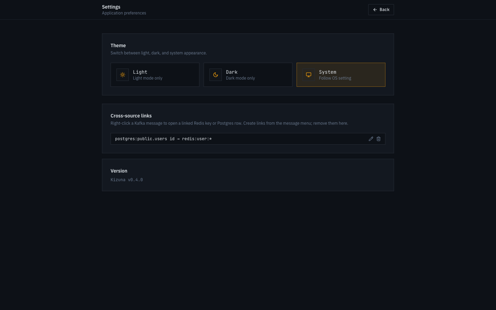
</p>

## One container

- Dark, light, and system themes.
- One Go binary with the embedded React frontend: one container, one port.
- Works with no internet: the frontend and its fonts ship inside the binary, and the app makes no outbound requests of its own.
- Lazy source connections and encrypted passwords in local configuration.

## Access and security

Kizuna is built for one user on one machine. It has no authentication — closed defaults stand in for it:

- The port listens on `127.0.0.1` only, both in Docker and when run from source. Otherwise anyone on a shared network (cafe, coworking space, office) would see your connections and run queries: the API decrypts stored passwords itself.
- Writes through the API require an `X-Kizuna-Client` header, which blocks requests another site makes from your browser. Your own scripts need to send it themselves.

If you do need network access, open the port deliberately and only behind an authenticating proxy:

```bash
KIZUNA_BIND=0.0.0.0 docker compose up -d   # publish beyond loopback
KIZUNA_LISTEN=0.0.0.0:9090 go run ./cmd/kizuna   # same, running from source
KIZUNA_ALLOWED_HOSTS=kizuna.internal       # if the proxy has its own hostname
```

## Changelog

Release history lives in [CHANGELOG.md](CHANGELOG.md).

## License

[Apache 2.0](LICENSE)
